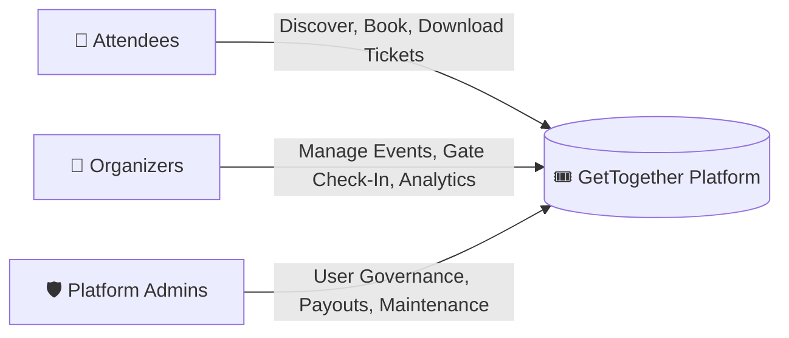
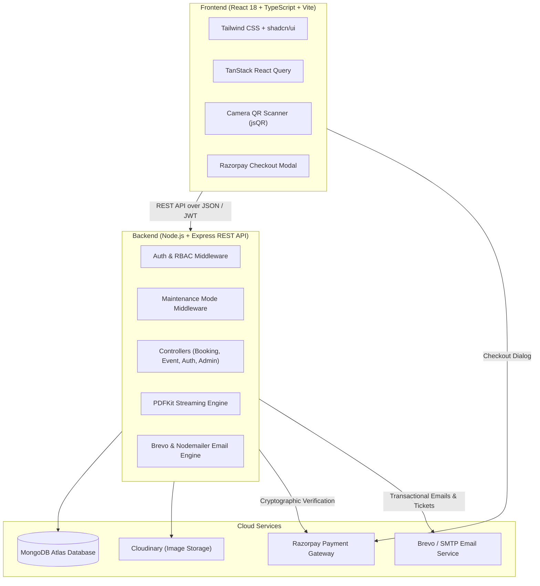

# 🎟️ GetTogether — Event Discovery, Ticketing & Gate Verification Platform

<div align="center">


<p align="center">
  <b>A comprehensive, production-ready MERN platform for seamless event management, multi-attendee ticketing, secure online payments, and camera-based gate QR verification.</b>
</p>

[Explore Features](#-key-features) • [System Architecture](#-system-architecture) • [Getting Started](#-getting-started) • [API Documentation](#-api-endpoints) • [Tech Stack](#-tech-stack)

</div>

---

## 🌟 Overview

**GetTogether** is an end-to-end event management and ticketing ecosystem designed to solve real-world logistical challenges for attendees, organizers, and platform administrators. Built on a resilient **MERN stack + TypeScript** foundation, it handles everything from browsing categorized events with dynamic filters, through secure **Razorpay** checkout and automated **PDF ticket generation**, to zero-hardware **in-browser camera QR scanning** at the venue door.

---

## 👥 Three Tailored Experiences



### 1. 👤 Attendee Experience
- **Dynamic Discovery**: Dark-mode UI with categorized filtering (Music, Tech, Workshops, Sports), search bar, and interactive typewriter headings.
- **Multi-Attendee Booking**: Reserve multiple seats in a single checkout with per-attendee names, emails, and internationally validated phone numbers (`libphonenumber-js`).
- **Flexible Authentication**: 
  - Traditional Email + Password with bcrypt encryption.
  - Passwordless 6-digit OTP login via email.
  - In-app self-service password reset via email OTP (no broken email reset links).
- **Instant Digital Tickets**: Automatic generation of A4 PDF tickets embedded with unique scannable QR codes sent via transactional emails.

### 2. 🎪 Organizer Dashboard
- **Full Lifecycle Event Management**: Create, update, publish, or cancel events with poster uploads powered by Cloudinary CDN.
- **In-Browser Gate Verification (Zero Hardware)**: 
  - Mobile & webcam camera QR scanner powered by `jsQR`.
  - Instant duplicate ticket detection (prevents reused/tampered QR codes).
  - Real-time check-in stats and attendance tracking.
- **Revenue & Analytics**: Monitor ticket sales velocity, total earnings, remaining seats, and request payouts.

### 3. 🛡️ Administrator Portal
- **Dedicated Admin Portal**: Segregated authentication and role-based permissions (`super-admin` / `admin`).
- **Platform Analytics**: Total revenue GMV, platform-wide user growth, and active event metrics.
- **User & Organizer Governance**: Inspect user profiles, roles, and event ownership.
- **Organizer Payout Management**: Review, approve, and track payout requests.
- **Global Maintenance Mode**: Instant platform-wide maintenance toggle returning `503 Service Unavailable` for public routes while keeping admin controls accessible.

---

## 🚀 Key Features

| Category | Feature | Description |
|---|---|---|
| 💳 **Payments** | **Razorpay Integration** | End-to-end payment modal with server-side HMAC-SHA256 signature verification to prevent tampering. |
| 📱 **Check-in** | **Camera QR Scanner** | Browser-based QR scanning directly from any laptop or smartphone camera for instant attendee admission. |
| 📄 **Ticketing** | **In-Memory PDF Engine** | PDFKit stream generator produces branded A4 tickets with individual QR codes on the fly without disk overhead. |
| 📧 **Notifications** | **Dual Email Engine** | Brevo API + Nodemailer SMTP with exponential backoff retry logic for zero dropped booking confirmations. |
| ☁️ **Media** | **Cloudinary Storage** | Cloud-stored, CDN-cached event poster images with automatic formatting and responsiveness. |
| 🔒 **Security** | **Enterprise Auth** | Stateless JWT authentication, role-based route guards, and encrypted password hashing via `bcryptjs`. |

---

## 🏗️ System Architecture



---

## 💻 Tech Stack

### Frontend
- **Framework**: [React 18](https://react.dev/) + [TypeScript](https://www.typescriptlang.org/)
- **Build Tool**: [Vite](https://vitejs.dev/)
- **Styling**: [Tailwind CSS](https://tailwindcss.com/) with custom dark theme gradients
- **UI Components**: [shadcn/ui](https://ui.shadcn.com/) (Radix UI primitives)
- **Data Fetching**: [TanStack React Query v5](https://tanstack.com/query/latest)
- **Icons**: [Lucide React](https://lucide.dev/)
- **QR Scanning**: `jsQR` & `@zxing/browser`

### Backend
- **Runtime**: [Node.js](https://nodejs.org/) (ES Modules)
- **Web Framework**: [Express.js](https://expressjs.com/)
- **Database**: [MongoDB Atlas](https://www.mongodb.com/) via [Mongoose ODM](https://mongoosejs.com/)
- **Authentication**: JSON Web Tokens (`jsonwebtoken`) & `bcryptjs`
- **File Uploads**: `multer` + `multer-storage-cloudinary`
- **Payments**: `razorpay` SDK with crypto signature validation
- **PDF Generation**: `pdfkit` & `qrcode`
- **Email Service**: `@getbrevo/brevo` & `nodemailer`
- **Data Validation**: `express-validator` & `libphonenumber-js`

---

## 📂 Project Directory Structure

```text
gettogether/
├── backend/
│   ├── config/             # Database connection & Cloudinary setup
│   ├── controllers/        # Business logic (Auth, Booking, Event, Admin, Payouts)
│   ├── middleware/         # JWT auth, role validation & maintenance mode
│   ├── models/             # Mongoose schemas (User, Event, Booking, Admin, OTP)
│   ├── routes/             # RESTful API route definitions
│   ├── utils/              # Email delivery & in-memory PDF ticket generators
│   └── server.js           # Server entry point
├── src/
│   ├── components/         # Reusable UI & role-specific components
│   │   ├── admin/          # Admin panels & layouts
│   │   ├── organizer/      # Verification scanner & event manager
│   │   └── ui/             # Radix / shadcn UI components
│   ├── contexts/           # Authentication state context
│   ├── lib/                # API client abstraction & utilities
│   ├── pages/              # Routed pages (Home, Events, Dashboards, Auth)
│   ├── App.tsx             # Route management & layout wrapping
│   └── main.tsx            # Application bootstrapping
├── public/                 # Static assets & icons
└── package.json            # Root configuration & scripts
```

---

## ⚡ Getting Started

### Prerequisites
Make sure you have installed:
- **Node.js** (v18 or v20+)
- **npm** or **bun**
- A **MongoDB Atlas** database connection URI
- (Optional for full features) Free API keys for **Cloudinary**, **Razorpay**, and **Brevo/Gmail App Password**

---

### Step 1: Clone the Repository

```bash
git clone https://github.com/dkvkaran06/Get-Together.git
cd Get-Together
```

---

### Step 2: Configure Environment Variables

#### 1. Backend Configuration
Create a `.env` file in the `backend/` folder:

```bash
# Inside backend/.env
PORT=5050
NODE_ENV=development
FRONTEND_URL=http://localhost:5173,http://localhost:8080,http://localhost:8081

# Database
MONGODB_URI=your_mongodb_atlas_connection_string

# Authentication
JWT_SECRET=your_jwt_secret_key_here

# Razorpay (Payment Gateway)
RAZORPAY_KEY_ID=your_razorpay_key_id
RAZORPAY_KEY_SECRET=your_razorpay_key_secret

# Cloudinary (Image Uploads)
CLOUDINARY_CLOUD_NAME=your_cloud_name
CLOUDINARY_API_KEY=your_cloudinary_key
CLOUDINARY_API_SECRET=your_cloudinary_secret

# Email Service (Brevo or Gmail SMTP)
BREVO_API_KEY=your_brevo_api_key
# Or standard SMTP:
EMAIL_USER=your_email@gmail.com
EMAIL_PASSWORD=your_16_char_gmail_app_password
EMAIL_FROM="GetTogether" <your_email@gmail.com>
```

#### 2. Frontend Configuration
Create a `.env` file in the project root:

```bash
# In the root directory (.env)
VITE_API_URL=http://localhost:5050/api
VITE_RAZORPAY_KEY_ID=your_razorpay_key_id
```

---

### Step 3: Install Dependencies & Run

#### Start Backend Server:
```bash
cd backend
npm install
npm run dev
```
> The API will start on **`http://localhost:5050`** and automatically establish MongoDB connectivity.

#### Start Frontend Application:
Open a second terminal window in the project root:
```bash
npm install
npm run dev
```
> The web app will launch at **`http://localhost:5173`** (or `http://localhost:8080`).

---

## 🔌 API Endpoints Reference

### 🔐 Authentication (`/api/auth`)
| Method | Endpoint | Description | Access |
|---|---|---|---|
| `POST` | `/api/auth/signup` | Register as User or Organizer | Public |
| `POST` | `/api/auth/signin` | Sign in with email and password | Public |
| `POST` | `/api/auth/send-otp` | Request 6-digit login OTP | Public |
| `POST` | `/api/auth/verify-otp` | Authenticate using OTP | Public |
| `GET` | `/api/auth/me` | Fetch authenticated session | Private |

### 🎪 Events (`/api/events`)
| Method | Endpoint | Description | Access |
|---|---|---|---|
| `GET` | `/api/events` | Browse all events (supports category & search) | Public |
| `GET` | `/api/events/:id` | Fetch specific event details | Public |
| `POST` | `/api/events` | Create new event with image upload | Organizer |
| `PUT` | `/api/events/:id` | Update event information | Organizer |
| `DELETE`| `/api/events/:id` | Remove event listing | Organizer |
| `GET` | `/api/events/organizer/my-events`| Get events created by logged-in organizer | Organizer |

### 🎟️ Bookings & Verification (`/api/bookings`)
| Method | Endpoint | Description | Access |
|---|---|---|---|
| `POST` | `/api/bookings` | Create booking & generate Razorpay order | Attendee |
| `POST` | `/api/bookings/verify-payment` | Validate signature & issue tickets | Attendee |
| `GET` | `/api/bookings/my-bookings` | List user ticket history | Attendee |
| `GET` | `/api/bookings/:id/download-pdf`| Download in-memory PDF ticket | Attendee |
| `POST` | `/api/bookings/verify-ticket` | Gatekeeper camera QR validation | Organizer |

### 🛡️ Administration (`/api/admin`)
| Method | Endpoint | Description | Access |
|---|---|---|---|
| `POST` | `/api/admin/auth/login` | Administrator login | Public |
| `GET` | `/api/admin/analytics/overview`| Platform GMV & user counts | Admin |
| `GET` | `/api/admin/users` | List & manage platform users | Admin |
| `GET` | `/api/admin/payouts` | Review organizer payout requests | Admin |
| `PUT` | `/api/admin/settings/maintenance`| Toggle global maintenance mode | Admin |

---

## 🔒 Security Highlights

- **Stateless JWT Authorization**: Tokens with standard expiry passed via Authorization headers.
- **Cryptographic Signature Verification**: Payments are confirmed solely on the server through HMAC SHA-256 verification against Razorpay secrets.
- **Data Protection**: User passwords are excluded by default from queries (`select: false`) and hashed with `bcryptjs`.
- **Duplicate Ticket Protection**: Every ticket possesses an individualized tracking record (`active` → `used`), stopping screenshot sharing at event gates.
- **Maintenance Shield**: System-wide circuit breaker middleware prevents public database mutations during upgrades while preserving admin access.

---

## 🤝 Contributing

Contributions make the open-source community an amazing place to learn, inspire, and create!
1. Fork the Project
2. Create your Feature Branch (`git checkout -b feature/AmazingFeature`)
3. Commit your Changes (`git commit -m 'Add some AmazingFeature'`)
4. Push to the Branch (`git push origin feature/AmazingFeature`)
5. Open a Pull Request

---

## 📄 License

Distributed under the **MIT License**. See `LICENSE` for more information.

---

<div align="center">
  <sub>Built with ❤️ by <a href="https://github.com/dkvkaran06">Dev Karan</a></sub>
</div>
